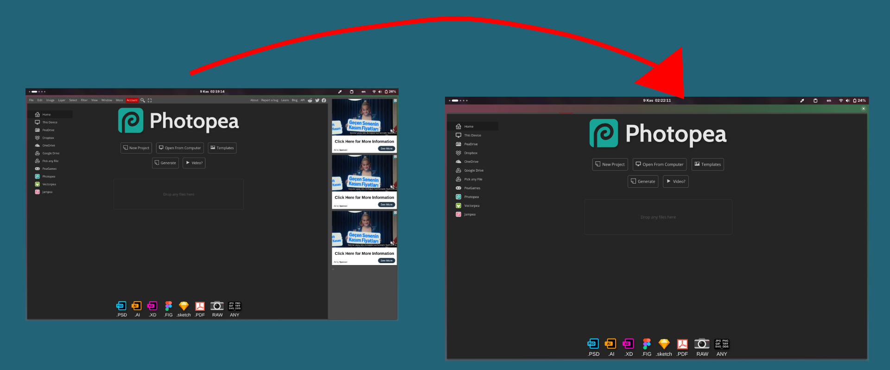
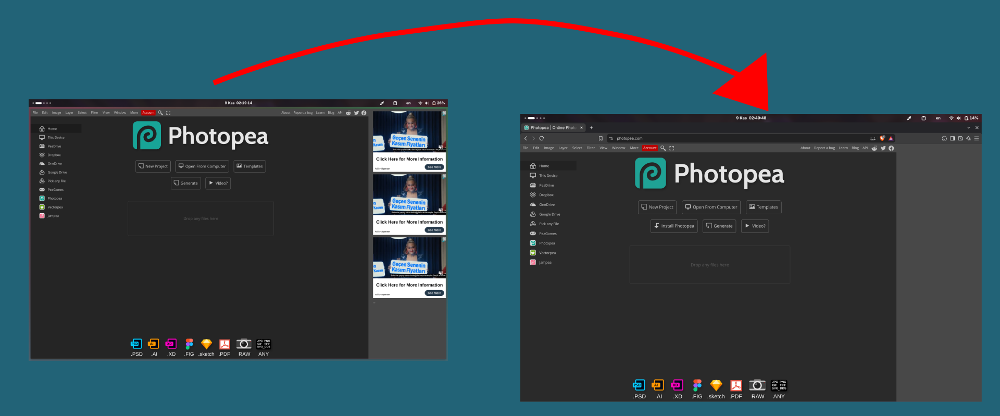

# Photopea No Ads Panel


An extension that removes Photopea's right-side advertisement panel.

This repository contains two builds:

| Folder | Browser | Manifest |
|---|---|---|
| `firefox/` | Firefox | MV2 |
| `chromium/` | Chrome / Brave / Edge / Chromium | MV3 |

Both builds do the same thing: they force Photopea's internal ad flag to
`true`, so the advertisement branch never runs.

---

## Why I Built This (with AI)

Yes, you can switch to the full version for something like a dollar. But that
was never the point for me. What really killed it was the business model
itself. Built on something this simple, and this easy to prevent.

Browsers are browsers: I can change anything I can see on my screen. Trying
to prevent that struck me as funny, so I made this extension.

I used AI to write the source code, btw. If you find that a deal-breaker, so
be it. If there is a way to make this extension without debugging minified
JS, I'm up for that method.

---

## How it works



Photopea's app script (`code/pp/pp*.js`) contains a layout function
(`cT.prototype.Sr`) that decides whether to show the right-side ad panel.

The extension rewrites one flag inside that function:

```js
// before
var K=eb.U$,D=!this.rX||this.uF()||!this.S.zB||hN.Dj()||...

// after
var K=eb.U$,D=!0;
```

When `D` is `true`, Photopea:

- does not create the ad panel,
- does not reserve extra layout space for it,
- does not load ad scripts/iframes.

Each build also ships a `style.css` fallback that hides the panel in case
the patch ever fails to match.

---

## Why not just use an adblocker?



An adblocker can stop the ad request, but it does not stop Photopea from
*reserving space* for the ad panel.

The panel is not a separate element injected by an ad network. It is part of
Photopea's own layout: the app script decides at startup whether to create an
ad host container and how much width to give it. If you block the ad iframe
with a filter, the request never fires, but the container still exists and
still takes its column of pixels — you end up with an empty vertical strip
instead of an ad, and the canvas stays narrow.

Cosmetic filters (`photopea.com##.something`) can hide that container, but
they depend on Photopea's current DOM structure and class names, which change
without notice, and hiding an element with CSS does not always reclaim the
layout space it was given.

This extension takes the other route: it flips the flag Photopea itself uses
to decide whether the ad branch should run. The panel is never created, no
width is reserved for it, and the editor simply gets the full window —
no guessing at selectors, and nothing to keep re-tuning when Photopea
updates its markup.

Adblockers are still useful for blocking the rest of the web's ads; this
extension just fixes the one thing a request blocker cannot fix here.

---

## Firefox installation

Firefox supports `webRequest.filterResponseData`, which lets the extension
patch the script response before the browser runs it.

### Temporary install

1. Open `about:debugging#/runtime/this-firefox`.
2. Click **Load Temporary Add-on…**.
3. Select `firefox/manifest.json`.
4. Reload `photopea.com` with **Ctrl+Shift+R**.

### Permanent install

Regular Firefox does not allow permanently installing unsigned extensions.
You can either:

- submit the add-on to [addons.mozilla.org](https://addons.mozilla.org/) for signing, or
- use Firefox Developer Edition / Nightly and set
  `about:config` → `xpinstall.signatures.required = false`.

To build the package:

```bash
cd firefox
web-ext build
```

---

## Chrome / Brave / Edge installation

Chrome and other Chromium browsers do **not** have
`webRequest.filterResponseData`. The `chromium/` build instead runs a script
in the page's MAIN world that intercepts Photopea's `pp*.js` script element,
patches the source, and inserts the patched version.

Photopea ships no Content-Security-Policy, so inline scripts are allowed.

### Temporary install

1. Open `brave://extensions` (or `chrome://extensions`, `edge://extensions`).
2. Enable **Developer mode**.
3. Click **Load unpacked**.
4. Select the `chromium/` folder.
5. Reload `photopea.com`.

### Permanent install

Submit the packaged zip to the
[Chrome Web Store Developer Dashboard](https://chrome.google.com/webstore/devconsole/).

Build the zip from the **contents** of `chromium/` (not the folder itself):

```bash
cd chromium
zip -r ../photopea-noads-chromium.zip manifest.json inject.js style.css icons
```

---

## Store listing assets

The `assets/logo/` folder holds the source artwork and the images to use on
the browser store listings and anywhere the add-on is presented. Everything
in it is derived from `assets/logo/photopea-no-add-panel.png`.

| File | Size | Where it goes |
|---|---|---|
| `assets/logo/icon-128.png` | 128×128 | Chrome Web Store listing icon, AMO add-on icon |
| `assets/logo/icon-512.png` | 512×512 | High-res icon for press kits / listings |
| `assets/logo/promo-440x280.png` | 440×280 | Chrome Web Store small promo tile |
| `assets/logo/marquee-1400x560.png` | 1400×560 | Chrome Web Store marquee / README banner |

To regenerate every icon and store image from the source PNG:

```bash
python3 - <<'PY'
from PIL import Image, ImageDraw
import numpy as np

TEAL = (9, 159, 146)
src = Image.open('assets/logo/photopea-no-add-panel.png').convert('RGB')
a = np.asarray(src).astype(int)
a[a.sum(axis=2) < 90] = TEAL          # flatten the dark corners
flat = Image.fromarray(a.astype('uint8'), 'RGB')

def rounded(im, size, radius_ratio=0.22):
    out = im.resize((size, size), Image.LANCZOS).convert('RGBA')
    mask = Image.new('L', (size * 4, size * 4), 0)
    ImageDraw.Draw(mask).rounded_rectangle(
        (0, 0, size * 4 - 1, size * 4 - 1),
        radius=int(size * 4 * radius_ratio), fill=255)
    out.putalpha(mask.resize((size, size), Image.LANCZOS))
    return out

for s in (16, 32, 48, 128):
    rounded(flat, s).save(f'chromium/icons/icon-{s}.png', optimize=True)
for s in (48, 96, 128):
    rounded(flat, s).save(f'firefox/icons/icon-{s}.png', optimize=True)
rounded(flat, 128).save('assets/logo/icon-128.png', optimize=True)
rounded(flat, 512).save('assets/logo/icon-512.png', optimize=True)

for w, h, logo, name in ((440, 280, 250, 'promo-440x280'),
                         (1400, 560, 520, 'marquee-1400x560')):
    canvas = Image.new('RGB', (w, h), TEAL)
    mark = rounded(flat, logo)
    canvas.paste(mark, ((w - logo) // 2, (h - logo) // 2), mark)
    canvas.save(f'assets/logo/{name}.png', optimize=True)
PY
```

---

## Usage

There is nothing to configure. Install the extension, then open
<https://www.photopea.com> and start the editor.

The right-side ad panel should be gone and the editor should use the full
width.

If you open the browser console, you should see logs like:

```text
[Photopea No-Ads] Ad branch disabled
[Photopea No-Ads] Ad width reservation removed
[Photopea No-Ads] Patched: code/pp/pp1794043082.js
```

---

## Terms and disclaimer

- This is an **unofficial** extension. It is not affiliated with, endorsed
  by, or sponsored by Photopea.
- "Photopea" is a trademark of its respective owner. This project only uses
  the name to describe compatibility.
- Photopea is a free, ad-supported service. Removing ads may be against
  Photopea's own terms of service. **Use it at your own risk.**
- The extension does **not** collect, store, or transmit any data.
- The extension does **not** unlock paid/Premium features; it only disables
  the advertisement branch.
- Photopea may change its code at any time. If the patch stops working, the
  ad panel may reappear. In that case, update the patterns in:
  - `firefox/background.js`
  - `chromium/inject.js`
- No warranty is provided. The software is provided "as is".

---

## Troubleshooting

### The ad panel is still visible

1. Hard reload Photopea: **Ctrl+Shift+R**.
2. Check the browser console for `[Photopea No-Ads]` logs.
3. If you see `Ad branch pattern not found`, Photopea changed its code.
   Update the patterns in `firefox/background.js` and `chromium/inject.js`.

### Firefox patch does not apply

- Make sure you loaded `firefox/manifest.json` (not the Chromium one).
- Try disabling cache in DevTools and reloading.

### Chrome/Brave patch does not apply

- Make sure you loaded the `chromium/` folder via **Load unpacked**.
- Rebuild/reload the extension after changing files.

---

## Repository layout

```text
photopea-no-ads-panel/
├── assets/
│   ├── how_it_works.png               # diagram used in "How it works"
│   ├── why_not_adblocker.png          # diagram used in "Why not just use an adblocker?"
│   └── logo/
│       ├── photopea-no-add-panel.png   # source artwork
│       ├── icon-128.png                # store icon
│       ├── icon-512.png                # high-res icon
│       ├── promo-440x280.png           # Chrome small promo tile
│       └── marquee-1400x560.png        # Chrome marquee / README banner
├── firefox/
│   ├── manifest.json      # Firefox MV2 manifest
│   ├── background.js      # webRequest.filterResponseData patch
│   ├── icons/             # 48/96/128 icons
│   └── style.css          # fallback
├── chromium/
│   ├── manifest.json      # Chromium MV3 manifest
│   ├── inject.js          # MAIN-world script interception patch
│   ├── icons/             # 16/32/48/128 icons
│   └── style.css          # fallback
├── README.md
├── LICENSE                # MIT
└── .gitignore
```

---

## License

The extension code in this repository is released under the
[MIT License](LICENSE).

Photopea itself is **not** covered by this license and is not distributed
here. "Photopea" is a trademark of its respective owner; the name is used
only to describe compatibility.
